# Uniteed

A small, lightweight map editor for **Teeworlds 0.6, 0.7, DDRaceNetwork and 0.8**, built
around **SDL3** and its 2D renderer, with text shaped by HarfBuzz and rasterized by
FreeType. It reads map files of datafile version 3, 4 and 5, and writes maps for each
of those ecosystems with the exact item versions their clients expect. Its own working
format is the `.unitwp` package, which keeps a map plus the editor state and,
optionally, the mapres files it needs.

The format layer is complete and verified across all five targets, the editor covers
viewing, tile painting, quad editing, envelope curves and autorules behind a dockable
workspace, and every operation is also available as a JSON method so the editor can be
driven by a script or an agent. See [What is here](#what-is-here) for the honest list of
what is and is not there yet.

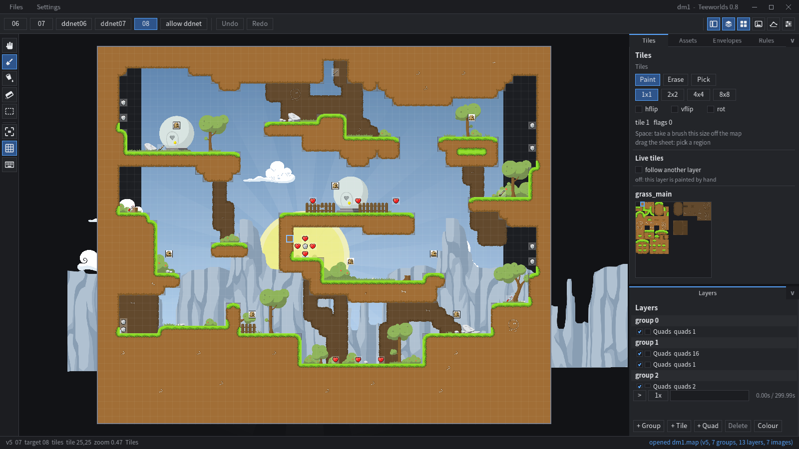

A vanilla Teeworlds 0.6 map next to a DDRaceNetwork one - same editor, different
mapres directory, which is exactly the point of the per version assets:

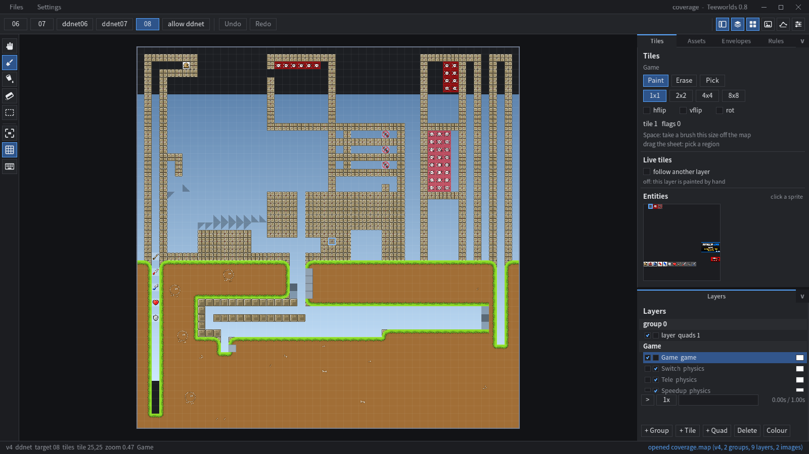
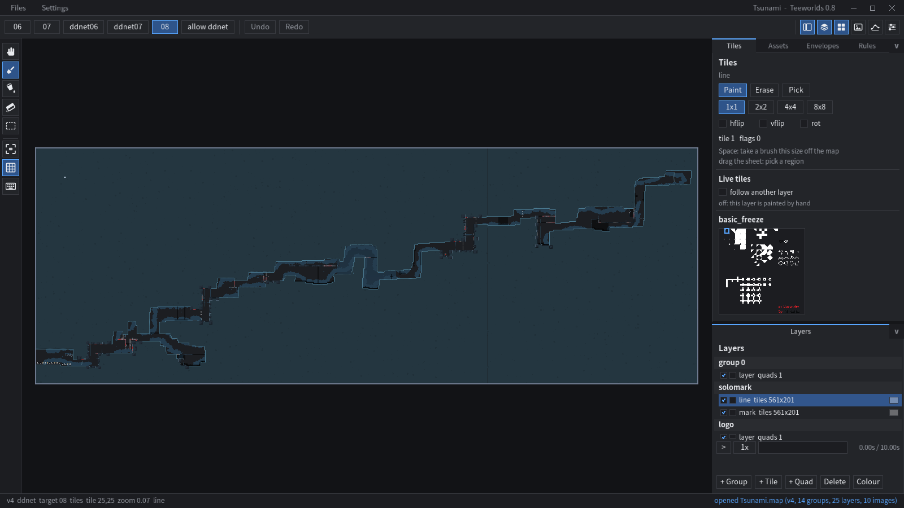

The canvas follows the selected layer: a tile layer gets the tile brush, a quad layer
gets its five editable points - four corners filled with the colour they carry, and the
yellow diamond that is the rotation pivot:

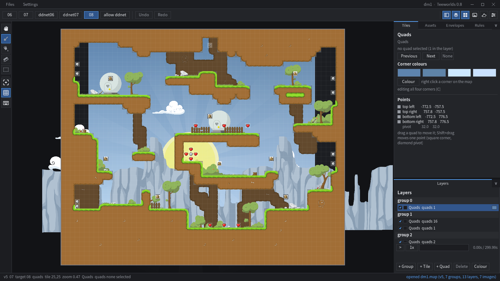

## Version matrix

The datafile container version and the map *item* versions are independent, which is
the whole reason the editor has explicit targets:

| target | datafile | tilemap item | image | group | envelope points | notes |
|---|---|---|---|---|---|---|
| `06` Teeworlds 0.6 | 4 (zlib) | 3, 72 B | 1, 24 B | 3, 60 B | 24 B or 88 B (bezier) | what the 0.6.1/0.6.5 editor writes |
| `07` Teeworlds 0.7 | 4 (zlib) | 4, 72 B, run length tiles | 2, 28 B | 3, 60 B | 24 B or 88 B (bezier) | 0.7.6 and later |
| `ddnet06` DDRaceNetwork 0.6 | 4 (zlib) | 3, 92 B with the physics data indices | 1, 24 B | 3, 60 B | 24 B or 88 B (bezier) | info item is 24 B, UUID items are preserved |
| `ddnet07` DDRaceNetwork 0.7 | 4 (zlib) | 4, 92 B, run length tiles | 2, 28 B | 3, 60 B | 24 B or 88 B (bezier) | the 0.7 protocol, same physics layers |
| `08` Teeworlds 0.8 | **5 (zstd)** | 4, 72 B, run length tiles | 2, 28 B | 3, 60 B | 24 B or 88 B (bezier) | the Archive fork |

`ddnet` on its own means `ddnet06`, which is what every existing DDRace map is: both
DDRace targets carry the physics layers, the DDRace game entities and the UUID items
that this editor does not model, and they differ only in whether the tile data may be
run length compressed. See [DDRace, and what the targets gate](#ddrace-and-what-the-targets-gate).

**A custom envelope curve is written the Teeworlds way in all five targets**: envelope
item version 3, with the bezier tangents packed into the 88 byte envelope point.
DDRaceNetwork has a separate UUID item for exactly this, and Uniteed deliberately does
not write it, so a curve means the same thing whichever client the map is exported
for. A UUID item that an imported map already carries is preserved verbatim.

Reading also accepts datafile version 3 (legacy, uncompressed data blocks). Teeworlds
0.6, 0.7, DDRaceNetwork and 0.8 map files all load.

## Building

Requirements: a C++23 compiler, CMake 3.16+, and the system libraries
`sdl3` (3.4 or later), `freetype2`, `harfbuzz`, `zlib`, `libzstd` and (optionally)
OpenSSL for the package UUIDs. Everything else is a git submodule.

There is no OpenGL code of our own: SDL3 owns the window and the renderer, and the
editor draws through a small painter in `src/engine/painter.cpp` that emits triangles.
The interface icons are SVG documents (`data/icons`), rasterized by
[nanosvg](https://github.com/memononen/nanosvg) - a header only submodule - at the
resolution the display asks for, so there is still no graphics library behind them. The text pipeline is FreeType for the
glyph bitmaps and HarfBuzz for shaping, which is what makes the CJK fallback work:
HarfBuzz reports the glyphs the interface font is missing and those runs are reshaped
with the fallback face.

```sh
git clone --recursive <this repository>   # or: git submodule update --init --recursive
cmake -S . -B build -G Ninja -DCMAKE_BUILD_TYPE=Release
cmake --build build
./build/uniteed                       # the editor window
./build/uniteed --help                # the command line
```

A headless build (no window, just the format tools) is available and needs neither
SDL3 nor a GPU:

```sh
cmake -S . -B build -G Ninja -DUNITEED_GUI=OFF
cmake --build build
./build/uniteed --selftest
```

### Fonts

The editor ships no fonts of its own; it asks the system for three faces — a regular
sans serif, its bold companion and one with CJK coverage — and each platform is
asked in the way that platform expects (`src/engine/font_find.cpp`):

| platform | where the faces come from |
|---|---|
| Windows | `%WINDIR%\Fonts` and `%LOCALAPPDATA%\Microsoft\Windows\Fonts`, plus the `Fonts` registry key, which is the only record of a font installed without copying a file into the directory. Segoe UI is preferred, then Tahoma/Verdana/Arial; the CJK face is Microsoft YaHei, then JhengHei, SimSun or DengXian. |
| macOS | `/System/Library/Fonts` and `/Library/Fonts` |
| Linux | `fc-match` when fontconfig is installed, then the usual distribution directories |

On Windows the font file is read into memory rather than opened by path: FreeType's
path based entry point takes a narrow string, which Windows reads in the active code
page, so a font under a non ASCII directory (`C:\Users\张伟\...\Fonts\...`) would not
open.

Any of the three can be overridden in `config.cfg` — `<data home>/uniteed/config.cfg`,
which is `%LOCALAPPDATA%\uniteed\config.cfg` on Windows and
`~/.local/share/uniteed/config.cfg` on Linux:

```
uniteed_font       C:\Users\me\Fonts\Inter-Regular.ttf
uniteed_font_bold  C:\Users\me\Fonts\Inter-Bold.ttf
uniteed_font_cjk   C:\Windows\Fonts\msyh.ttc
```

An override that does not exist is reported as a warning and the system lookup runs
instead, so a typo never leaves the editor without a font.

## Command line

```
uniteed [map]                       open the editor, optionally with a map
uniteed --gui [map]                 the same
uniteed --titlebar system|client    draw the title bar, or let the system draw it
uniteed --new out.map [--target id] [--size WxH]
uniteed --dump map                  print groups, layers, images, envelopes
uniteed --convert in out.map --target id
uniteed --pack in out.unitwp [--embed]
uniteed --unpack in.unitwp out.map --target id
uniteed --render map out.png [opts] draw the map's tiles and quads to a PNG
uniteed --targets                    print the version matrix
uniteed --selftest [map ...]         round trip every bundled map through every target
uniteed --screenshot out.png [map]   render one frame offscreen and exit
uniteed --agent                      a resident JSON session on stdin and stdout
uniteed --agent-describe             the agent method catalogue
uniteed <method> [--key value ...]   one administrative method, as JSON
```

`--target` takes `06`, `07`, `ddnet`, `ddnet06`, `ddnet07` or `08`. `--pack --embed`
puts the mapres PNGs the map references into the package so it can travel on its own,
and `--unpack` reads a saved project as well: a `.unitwp` is the same container either
way, so a map can be recovered from the file the editor was working in.

`--render` is the headless picture: it draws the tile and quad layers of every
group — through the same parallax, clipping, layer colour and envelope evaluation
the canvas uses — into a PNG, without a window and without a display. `--center
X,Y` is the world pixel at the middle (the map centre when left out), `--size WxH`
the picture size (800x600), `--zoom` the scale, `--time` the envelope clock in
seconds, `--transparent` leaves the background clear, and `--background RRGGBB`
sets it. Game and physics layers are editor affordances, so a render leaves them
out.

```
$ ./build/uniteed --render data/maps/06/dm1.map build/dm1.png --size 1200x900 --zoom 0.6
rendered 1200x900 to build/dm1.png: 7 groups, 13 layers, 1422 tiles, 23 quads, 7 images
```

Every administrative method is also a subcommand, so the whole editor is drivable
without a window:

```
$ uniteed project.create --name demo --target ddnet07 --width 32 --height 32
$ uniteed rules.add_rule --tile 1 --when '[{"at":[1,0],"is":["death"]}]'
$ uniteed rules.apply --group 1 --layer 0
$ uniteed export.map --target ddnet07
```

Each one prints one JSON document, and `uniteed --agent` keeps the session alive so a
script can make a hundred edits without starting the editor a hundred times. The whole
reference is in [docs/AGENT.md](docs/AGENT.md); `uniteed --agent-describe` prints the
catalogue. The same renderer is the `render.map` method, so a script can picture a
map without shelling out to the command line.

The screenshot mode is also how the interface is checked without a display, so it can
be told which state to render and can be driven with real input events:

```
uniteed --screenshot out.png map --layer G:L     select group G, layer L
                                                  ("G:" selects the group row itself,
                                                  which is the group's properties)
uniteed --screenshot out.png map --quad N        select quad N (default: the first)
uniteed --screenshot out.png map --corner N      aim the picker at corner N (0..3)
uniteed --screenshot out.png map --color         open the colour picker
uniteed --screenshot out.png map --time S        set the envelope preview clock
uniteed --screenshot out.png map --move X,Y      move the cursor
uniteed --screenshot out.png map --click X,Y[,B] move, press and release button B
uniteed --screenshot out.png map --click-point Q:P[,B]
                                                  the same, aimed at point P of quad Q
                                                  (0..3 are its corners, 4 the pivot),
                                                  which is how a script colours a corner
uniteed --screenshot out.png map --press B        press button B, held until --release
uniteed --screenshot out.png map --release B      release button B
uniteed --screenshot out.png map --scroll N       turn the wheel, so the canvas zooms
uniteed --screenshot out.png map --key K          press key K (a lowercase SDL_Keycode: 98 is "b")
uniteed --screenshot out.png map --mods M         modifiers for the next --key
uniteed --screenshot out.png map --language ID  build the interface in that language
                                                  ("en", "zh-Hans")
uniteed --screenshot out.png map --dock UPPER:LOWER which workspace each docker shows
uniteed --screenshot out.png map --menu files|settings  open a menu of the title bar row
uniteed --screenshot out.png map --envelope N:P   select an envelope and one point of it
uniteed --screenshot out.png map --ui-scale N     rasterize the vector icons at N times
                                                  the layout size
uniteed --screenshot out.png map --ui-scale-change N
                                                  the same, switched to after the first
                                                  frame, so the icons re-rasterize
uniteed --screenshot out.png map --reopen other  open another map after the first frame,
                                                  which is what a texture that follows a
                                                  map switch has to survive
uniteed --quit-after N                           run a windowed session for N frames and
                                                  quit as if it had been closed, which is
                                                  how the settings it saves are checked
uniteed --screenshot out.png map --double-click X,Y[,B]  both presses of a double click
uniteed --screenshot out.png map --type TEXT     type text into the field that is open
```

`--dock` takes `layers`, `tiles`, `assets`, `envelopes` or `rules` for each of the two
stacked dockers, so any pair can be captured; `--envelope` picks the one the curve editor
shows and one of its points.

Each option is one frame of input, exactly what the window would receive from a mouse
and a keyboard, so a sequence of them reproduces a real interaction and the last frame
is written out. `--titlebar`, `--menu` and `--quit-after` are not input: they configure
the window itself, and they work on an ordinary run as well as on a screenshot.

`tools/screenshots.sh` is that recipe as a script: it rebuilds every image in this
README (including the autorules project, which it creates through the agent interface),
so a layout change means running it again rather than cropping a picture by hand.

`tools/verify_map.py` is an independent checker: it re-implements the container
layout in Python and validates a map from the outside (table consistency, every data
block, every tile layer expanding to exactly `w*h` tiles, quad and sound element
counts, envelope ranges). It shares no code with the editor, and it passes on the
bundled reference maps as well as on everything the editor writes.

`--selftest` is the regression test of the format layer: for every bundled map it
loads the map, exports it to all five targets, reloads the result, compares the
structure, the tiles and the preserved items, checks that a repeated save is stable,
and does the same through a `.unitwp` package round trip — plus a project round trip
that pins the metadata, the editor session and the autorules, a check that the SVG
icons of the interface parse and rasterize at two sizes without a window, and a check
that the window furniture of the drawn title bar - the drag, the eight resize edges and
the buttons that must stay clickable - answers for every point of a window.

```
$ ./build/uniteed --selftest
...
72 checks, 0 failures

$ python3 tools/verify_map.py build/tmp/dm1_08.map data/maps/06/coverage.map
ok   build/tmp/dm1_08.map: datafile v5 35 items, 24 data blocks, 6 tile layers, 5 envelopes / 11 points
ok   data/maps/06/coverage.map: datafile v4 19 items, 17 data blocks, 8 tile layers, 0 envelopes / 0 points
```

## Projects, and where the files go

A `.map` file can only hold the map, and an editor needs more than that. Uniteed keeps
its own work in a **project**: one `.unitwp` file under the application data directory
that holds the map, the editor state, the autorules and the metadata. It is the same
binary container the `--pack`/`--unpack` tools and `export.package` use — a project *is*
a package, with the extra chunks filled in.

```
~/.local/share/uniteed/                  %LOCALAPPDATA%\uniteed on Windows
  config.cfg                             the settings
  projects/                              what Ctrl+S writes
    demo.unitwp
    dungeon.unitwp
  export/                                what Export writes
    06/demo.06.map
    07/demo.07.map
    ddnet06/demo.ddnet06.map
    ddnet07/demo.ddnet07.map
    08/demo.08.map
```

The projects directory is where a mapmaker's work lives, and the export directory is
where finished maps go; both are created on first use, and both can be pointed
somewhere else with `UNITEED_PROJECTS_DIR` and `UNITEED_EXPORT_DIR`, which is what a
portable install or a test wants. The exports are grouped by target so the same project
can be exported for every client without the files colliding.

A project is a binary container, so it is small and exact rather than readable; the
chunks inside it are:

```
UNITWP\0\1   version 1, flags
META   key=value text: id, name, author, description, target, assets, created, updated
MAP    the map itself, a real datafile written for the package profile
EDIT   JSON: the editor session — camera, brush, selection, dock layout, layer flags
RULE   JSON: the autorules document
RSRC   the mapres files the map needs, when the project carries them
THUM   a PNG thumbnail, when one has been made
```

The map is stored as a real datafile rather than as a bespoke object graph, so a project
round trips through exactly the format layer the export uses and nothing the editor does
not model can be lost. The `EDIT` chunk is the state that lets a reopened project resume
where it was, and `RULE` is the autorules document. `--unpack` reads either kind of
`.unitwp` back into a plain `.map`, and `strings` on a project shows the metadata and the
two JSON documents.

### Opening and saving

`Ctrl+O`, `Ctrl+S`, `Ctrl+Shift+S` and Export all go through the **platform's own file
dialog**. There is no file list drawn inside the window: a browser is the one piece of an
application the operating system always does better, and every mapmaker already has their
bookmarks and their network shares set up there. The dialogs are asynchronous, so a
request is remembered and completed on a later frame; the editor keeps working while one
is open.

A plain `.map` can still be opened directly — it becomes a project the first time it is
saved, and `Ctrl+S` asks for a name then. A name typed without an extension in the save
dialog becomes a `.unitwp` project, so the editor state is never lost by accident; a
name ending in `.map` is saved as a package instead, which is the file to hand to a
client.

Where SDL has no dialog backend — a bare server, a console session — the Files menu grows a
**Browse** button that opens the built-in file list instead, so the editor is never left
without a way to open a file. On a normal desktop the button is not there.

## The editor

The canvas edits **whatever the selected layer is**. There is no mode to switch:
select a tile layer in the layer tree and you paint tiles, select a quad layer
and you drag its points. The status bar says which of the two is active (`tiles`,
`quads`, or `read only` for a layer that cannot be edited, like a DDRace
physics layer), and the docks only ever show the controls that apply.

### Languages

The interface is in English and in **简体中文**, and the language is a data file rather
than a build: `data/lang/zh-Hans.json` holds the translations, the settings menu lists
whatever is installed, and the choice is remembered in the settings file
(`uniteed_language`). A session whose desktop locale asks for Chinese starts in Chinese
on the first run, and `--language en|zh-Hans` pins one for a single run, which is how the
reference screenshots stay English on any machine.

A catalog is one JSON document, and its keys are the English sentences the interface is
written with:

```json
{
	"id": "zh-Hans",
	"name": "简体中文",
	"strings": {
		"Files": "文件",
		"opened {} (v{:d}, {:d} groups, {:d} layers, {:d} images)": "已打开 {}（v{:d}，{:d} 组，{:d} 图层，{:d} 图像）"
	}
}
```

Adding a language is dropping another file in `data/lang`: the `id` (the file name by
default) is what the settings file and `--language` use, and `name` is the language's own
name, which is what the menu shows. A string the catalog does not have is drawn in
English, so a translation can be finished in pieces, and `python3 tools/lang.py check`
prints what a catalog is still missing - and what it carries that no longer exists in the
interface.

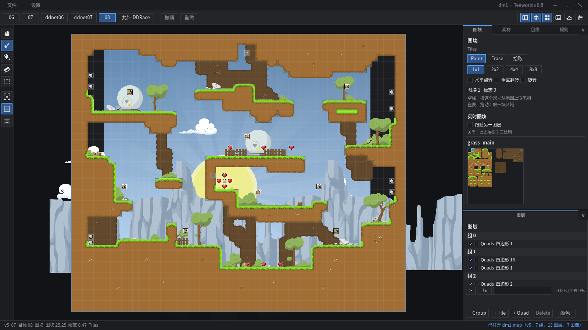

### The workspace

The interface is built like a Krita workspace, with the chrome a drawing application
puts above the canvas. The top row is the **menu bar**, which is also the title bar of a
window that draws its own decorations: the two menus on the left (`Files` and
`Settings`), the title of what is open, and the three window buttons on the right. The
row under it is the **toolbar**: the target the map is written for, the two steps through
the edit history, and the shortcuts that show and hide the panels. The far left is a
**tool box**, a vertical strip of the tools the canvas has and then the view toggles, at a
fixed size that does not move when anything else changes. Everything else is one column
of **dockers on the right**, which is where Krita puts its panels:

```
+-------------------------------------------------------------+
| Files  Settings      the project              - [] X        |  <- menu bar / title bar
+-------------------------------------------------------------+
| 06 07 ddnet06 ddnet07 08 | ext | undo redo        panels    |  <- toolbar
+------+----------------------------+-------------------------+
| tool |                            |  Tiles                  |  <- upper docker
| box  |           canvas           |  Assets                 |
|      |                            |  Envelopes              |
|      |                            |  Rules                  |
|      |                            +-------------------------+  <- draggable split
|      |                            |  Layers                 |  <- lower docker
+------+----------------------------+-------------------------+
                                      ^ draggable edge
```

`Files` holds everything that reads or writes a file (new, open, reopen the last one,
save, save as, export, quit) with each shortcut spelled out beside it, and `Settings`
holds what the session shows: the tile grid, the tool strip, the shortcut list, and
whether the window is drawn with its own title bar. Both close on `Escape` or a click
outside, and while one is open nothing behind it reacts to the mouse — a menu row that
covers a toolbar button is a menu row, not a button.

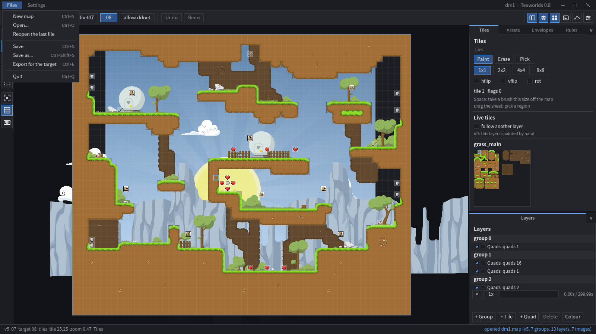

The window **has no system title bar** unless you ask for one: the editor draws its own,
which is what puts the file operations in a menu instead of a strip of buttons and gives
the row below to the map. What the title bar would have provided comes back from the hit
test the engine installs on the drawn bar, so dragging the empty part of it moves the
window, dragging an edge resizes it (the cursor changes shape there), double clicking it
maximizes, the right button asks the desktop for its own window menu, and the three
buttons at the right end minimize, maximize and close.

If a compositor will not cooperate — the window cannot be moved, or the drag stutters —
`Settings > Draw the title bar` turns the drawn one off for the rest of the session, and
`uniteed --titlebar system` starts without it; the menu bar then drops the three window
buttons, because the system already draws them. Only `uniteed_client_decorations false`
in the settings file survives a restart, which is what to write once the choice is
settled. A platform whose windows cannot be hit tested at all keeps its decorations whatever
the setting says: a window nobody can move is worse than a title bar.

A wide window shows every button of the toolbar; below roughly 750 pixels it drops the
buttons that no longer fit and ends with a `...` that says so when it is hovered. The
keys still work, and a wider window shows them again. The menu bar itself always fits,
because it is two buttons wide.

The tools are **drawn icons**, not letters, because a letter is only readable to
whoever already knows the key. Every one of them is an SVG document in `data/icons`,
one file per icon, white so the theme can colour it:

| icon | tool | key | what it does |
|---|---|---|---|
| hand | Pan | `V` | drag the view without changing the map |
| brush | Brush | `B` | paint the brush under the cursor |
| bucket | Fill | `F` | flood one tile region with the brush |
| eraser | Eraser | `E` | the eraser, and `E` again goes back to the tool before it |
| dashed rectangle | Pick | `P` | drag a rectangle of the map into the brush |
| brackets | Fit | `Ctrl+0` | frame the whole map in the window |
| grid | Grid | `G` | show the tile grid |
| keyboard | Keys | `?` | the shortcut list |

The toolbar has its own six pictograms, which are the shortcuts to the panels rather
than to the canvas: the tool strip, and then the five dockers. One that is showing is
lit, and clicking it folds that docker away; one that is hidden is dim, and clicking it
brings the workspace back to the docker it belongs to. So the whole layout is reachable
without hunting for a tab strip:

| icon | what it shows and hides | where the workspace lives |
|---|---|---|
| a strip beside a page | the tool strip on the left | not a docker, so it simply folds away |
| three stacked sheets | Layers | the lower docker |
| four squares | Tiles | the upper docker |
| a picture | Assets | the upper docker |
| a curve with points | Envelopes | the upper docker |
| three sliders | Rules | the upper docker |

Every letter names its tool - `B` the brush, `F` the fill, `P` the picker, `V` the
view - which is the one thing the old letters did not do. `E` is **not** a fifth tool
but Krita's eraser toggle: it drops into the eraser and, pressed again, returns to
whatever was in use, so erasing in the middle of painting never costs the brush. The
digits `1 2 3` are the same three painting tools in the order the panel lists them.

Hovering **anything** names it in a tooltip and repeats what it does in the status bar,
so nothing has to be guessed. The strip opens its tip beside the button with the name
and the key (`Brush  (B)`); the menu bar says what each menu is for, the toolbar says what
a button does and which docker a panel button works; the dock tabs say what their
workspace is for; the
layer tree names a layer and its size, and what its two checkboxes do; the palette says
what each size and flip means, and which entity the cell under the cursor is; the asset
browser describes an image, a sound and what it would do to it. A tool that needs a tile
layer says so instead of vanishing — the four tile tools grey out on a quad layer rather
than disappearing, so the strip never reflows under the cursor.

The drawings are **vector textures**: the document is parsed once, and rasterized at
the size the display actually needs, so an 18 pixel icon becomes an 18 pixel texture on
an ordinary display and a 36 pixel one on a display with twice the density, instead of
one small bitmap that has to be magnified and goes soft. The density is read from the
window every frame, so a window dragged to another monitor - or `uniteed_ui_scale` in
the settings - makes the icons rasterize themselves again; each one remembers the pixel
size it was made at, and only the ones on screen are re-made.

The upper docker is for the workspace you are working *with* (the tile palette, the
asset browser, the curve editor, the rules), and the lower one is the **layer tree**,
which is where a map maker keeps an eye on the map while painting. Each docker is a tab
strip plus the workspace the tab selects; the split between them and the width of the
whole column are both draggable, and a docker collapses to its tab strip with the arrow
at its inner end. **A tab can be dragged**: dropping it in another slot reorders that
docker, dropping it on the other docker moves the workspace there, and an accent bar
shows where it will land. The tab order, the widths, the heights and the collapsed
states all travel with the project.

**Double clicking a row of the layer tree renames it**, a group as well as a layer: the
name that was there comes up selected, so the first letter typed replaces it, `Enter` or
a click anywhere else keeps what was typed and `Escape` leaves the name as it was. While
the field is open it owns the keyboard, so a name is never also a shortcut, and the
rename is one step of the undo history like any other edit.

**Clicking a group row selects the group itself**, and the right panel then shows the
properties every layer under it is drawn through rather than a layer's tools: the
**parallax** it scrolls at, the **offset** it is drawn with and the **clip rectangle**
that cuts it off. A value is a small stepper - the arrows nudge it, dragging on the
field scrubs it - so a percentage and a coordinate are edited the same way, and one
scrub is one step of the undo history. The clip fields fold away while clipping is
switched off:

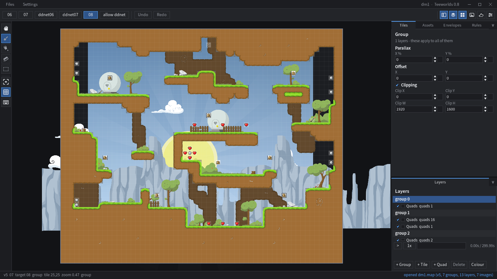

Two panels are **floating** rather than docked, because they are about the session
rather than about the map: the **welcome page** (new map, open a project or a map,
reopen the last one, open the shortcut list) and the **shortcut list** (`?`, or the
*Keys* button in the tool strip).

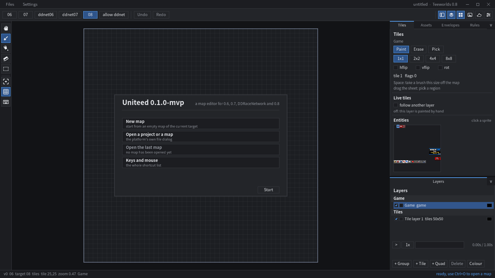

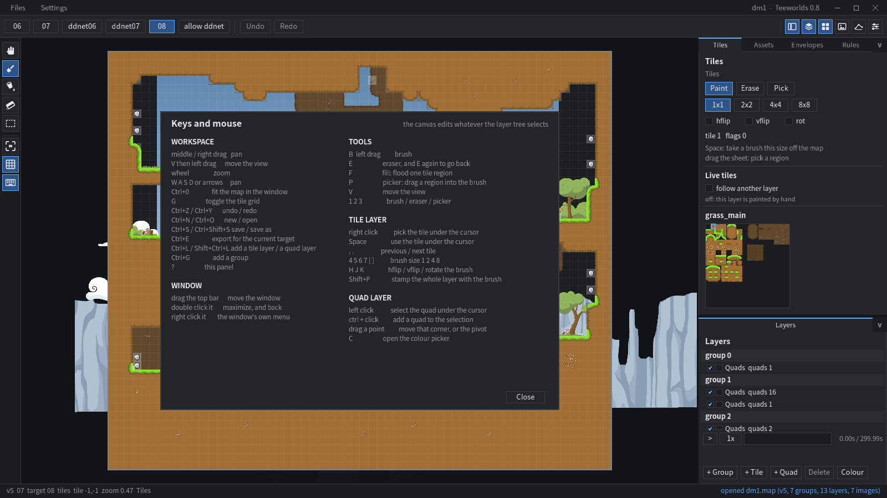

| docker | what it is for |
|---|---|
| **Layers** (lower) | the groups and layers, visibility and locks, add and delete |
| **Tiles** (upper) | the tile sheet and the live tiles of the selected layer, or the entity palette of a game layer |
| **Assets** (upper) | the images and sounds the map carries, with thumbnails (see below) |
| **Envelopes** (upper) | the curve editor (see below) |
| **Rules** (upper) | the autorules workspace (see below) |

Layers and Tiles are where the editor started; the other workspaces are the reason the
docks are movable, because drawing a curve, building a rule set and browsing artwork all
want height, while painting tiles wants the palette and the canvas.

### The tile and quad canvas

| key | action |
|---|---|
| **tile layer** | |
| left drag | paint the brush |
| right click | take a brush the size of the current one off the map |
| `Space` | the same, as a key |
| drag the palette | select a region of the sheet as the brush |
| drag with the pick tool | select a region of the map as the brush |
| `,` `.` | previous, next tile index |
| `1 2 3` | brush, eraser, picker |
| `B` `E` `F` `P` `V` | the tools, and `E` toggles the eraser |
| `Shift+P` | stamp the whole layer with the brush |
| `4 5 6 7`, `[` `]` | brush size 1, 2, 4, 8 |
| `H J K` | hflip, vflip, rotate the brush |
| `P` | fill the whole layer with the brush, tiled |
| **quad layer** | |
| left click | select the quad under the cursor |
| left drag | move the selected quads |
| `Shift` + drag a point | move that one corner, or the pivot |
| `Ctrl` + left click | add a quad to the selection |
| right click a corner | colour that corner: the picker opens aimed at it |
| right click inside a quad | colour its four corners at once |
| `C` | colour picker for the quad, or for the corner it is aimed at |
| **both** | |
| middle / right drag | pan |
| wheel | zoom |
| `W A S D`, arrows | pan |
| `Ctrl+0` | fit the map to the window |
| `G` | toggle the tile grid |
| `Ctrl+Z`, `Ctrl+Y` | undo, redo (32 steps, per layer) |
| `Ctrl+N` | new map |
| `Ctrl+S` | save the project (the file dialog asks; `Ctrl+Shift+S` always asks) |
| `Ctrl+E` | export the map for the target shown in the toolbar, through the system file dialog |
| `Ctrl+L` | add a tile layer (`Ctrl+Shift+L` adds a quad layer) |
| `Ctrl+G` | add a group |
| double click a row in the layer tree | rename that layer, or that group |
| `Delete` | delete the layer (`Shift+Delete` deletes the group) |
| `Space` | run / pause the envelope preview (on a quad layer) |
| `-`, `=` | envelope preview slower / faster |
| `Ctrl+Q` | quit |
| **the window** | |
| drag the menu bar | move the window |
| drag an edge | resize the window (the cursor changes shape there) |
| double click it | maximize, and back |
| right click it | the desktop's own menu for the window |
| the three buttons | minimize, maximize, close |
| `Files`, `Settings` | the two menus of the menu bar (they close on `Escape`) |
| the six pictograms | show or hide the tool strip and each docker |

Settings (the window size and whether it was maximized, the brush size, the default
target, the last opened map) are kept in `~/.local/share/uniteed/config.cfg` and written
when the editor exits. The remembered size is the **resting** one - what the window is
when it is neither maximized nor minimized - and the maximized flag is kept next to it,
so a session that ended maximized opens maximized again instead of the window growing a
little every restart. The stored height is everything *below* the title bar: with the
system title bar that is the client area as it is, and with the drawn one the menu bar is
added to the window when it opens and taken back off when it is saved, so turning the
drawn bar on does not shrink the canvas. `uniteed_ui_scale` is the one worth knowing
about on a large display: it is how many pixels per layout pixel the vector drawings
of the interface are rasterized at, so `2` gives the icons twice the resolution
(smoother, four times the texture memory) without changing the layout.
`uniteed_client_decorations` is the one to look for if the window cannot be moved
under your compositor: `false` brings the system title bar back, and
`Settings > Draw the title bar` does the same thing without a restart.

### The tile canvas

The brush is a **stamp**, not a single index: a 1x1 stamp is the plain tile brush, and a
rectangle of the sheet is a stamp that paints a whole block at once. Dragging over the
palette takes that rectangle, and the pick tool does the same on the map itself — press
on a tile, drag over the region that should become the brush, and let go. `Space` and
the right button take a region the size of the current brush, so a 4x4 selection reads
4x4 off the map and puts 4x4 back down. Every cell keeps its own flips and rotation, so
a piece of a map can be copied and stamped again unchanged.

The canvas shows the brush under the cursor as a **ghost**: each cell of the stamp is
drawn faded with its own rotation and flips, the block is outlined, the cell under the
cursor is marked, and at a comfortable zoom the panel's tile index is repeated next to
the cursor with `hflip`, `vflip` and `rotate` spelled out. Picking a region on the map
shows a marquee while the button is held, and the brush only changes when it is let go.

The palette on the right shows the 16x16 tile sheet of the selected layer's image, so
picking a tile is a click. The tile index printed in the panel is a readout of what
`Space`, the palette or `Q`/`E` selected, not something to type. The layer tree in the
lower docker lists the groups and layers with visibility and lock toggles, and shows a
tile layer's colour as a swatch; clicking the swatch opens the picker. DDRace physics
layers are locked because their payload is not editable in this version.

A 3x3 region of the sheet picked as the brush, its ghost stamp on the map and the cell
under the cursor spelled out:


### The quad canvas

A quad is five stored points: four corners and the pivot the position envelope turns
around. Selecting a quad draws all five of them on the map — a **square** for each
corner, filled with the colour that corner carries, and a yellow **diamond** for the
pivot. A plain drag moves the **whole quad**: a press on a handle, or anywhere inside
the quad, carries the selection with the cursor, and `Shift` is what grabs a single
point instead. That keeps the shape from being bent by a stray drag, and it is how a
quad is moved around the map. Corner handles show where the position envelope has moved
the corner to, so dragging one subtracts the envelope's current offset and rotation
again and the handle stays under the cursor.

Only the layer being edited draws quad outlines: the other quad layers are still filled
in, but they are not boxed, so selecting a quad does not cover the map in the boundaries
of the layers underneath it.

The right panel lists the four corners with their current map coordinates and their
colours. Which corner is being coloured is decided **on the map**: a right click on a
corner opens the picker aimed at that corner, and a right click inside the shape widens
it to the four corners at once. The panel only reads the four colours back (the aimed
one is outlined), and the picker popup shows the same four swatches live so a gradient
can be built corner by corner without closing it. The status bar reports how many quads
are selected.

Selecting a quad tests the **animated** points, the same ones that are drawn: a quad
whose position envelope has moved it is picked where it appears on the map, not where
its coordinates are stored.

### Colours and the envelope preview

A tile layer colour is a real RGBA multiplier over the tiles, applied the way the
client applies it: always, and combined with the layer's colour envelope. Quads are
drawn with all four of their corner colours (a smooth gradient over the quad) instead
of one flat colour, and a quad's position envelope moves and turns it.

Envelopes run on the editor's own clock, in the bar at the bottom of the layer panel:
play/pause, a speed from 0.25x to 8x, and a track you can scrub to sit at an exact
time. Scrubbing pauses, so the picture is reproducible. The evaluation is the reference
one down to the details — the time wraps at the last point, before the first point the
last value is used, the curve of the point before the time decides the interpolation
(step, slow, fast, smooth, linear and bezier with its tangents), and the values are
22.10 fixed point.

The picker edits the selected tile layer's colour, or a quad's colour: one corner when a
right click landed on it, all four when it landed inside the shape. Opened from the map it
sits **beside** the point that was clicked, so the corner being coloured stays visible; near
an edge of the canvas it flips to the other side of that point instead of leaving the view.
Clicking anywhere else closes it, and `Escape` does the same. Everything is undoable
(`Ctrl+Z`) and is written out by every export target.

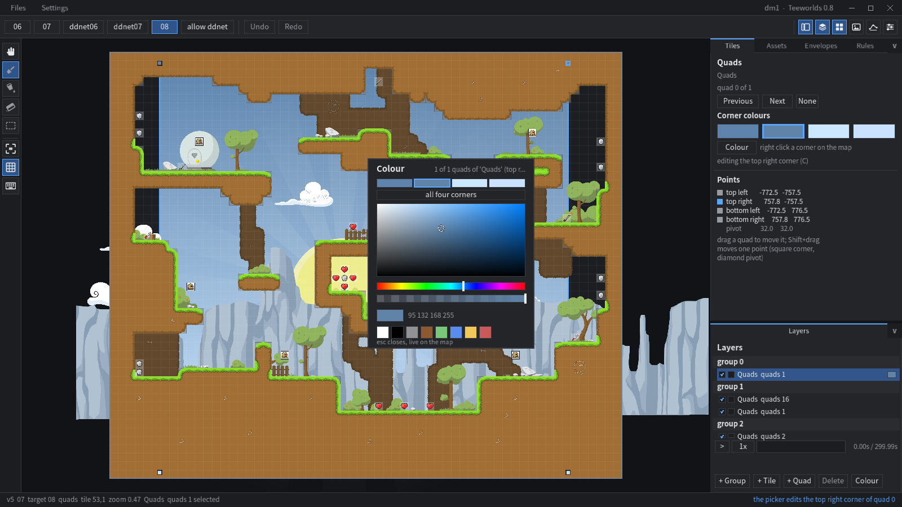

### The envelope editor

An envelope is a set of keyframes that drive a colour or a position, and the envelope
workspace is a curve editor for them: time runs along the bottom, the fixed point value
up the side, and every keyframe is a handle on the curve.


| action | |
|---|---|
| click a handle | select that keyframe |
| drag a handle | left and right change its time, up and down its value |
| `Ctrl` + click on the plot | add a keyframe there |
| right click a handle | delete it |
| wheel over the plot | zoom the time axis around the cursor |
| `shift+T` | switch the channel pair the plot shows |
| `B` | toggle the value grid |

The plot shows the **two channels of the selected pair** and the curve is sampled through
the same evaluator the client uses, so what is drawn is what will play. The point list
under the curve carries every keyframe with its exact time, curve type and four channel
values in 22.10 fixed point, and the curve type of the selected keyframe is editable
there: step, linear, slow, fast, smooth and **bezier**. The two channels in a pair are
drawn in different colours and each is labelled with its value at the preview clock, so
a gradient can be built corner by corner and watched.

The y range is fitted to the envelope being shown and snapped to a power of two. A fixed
range cannot work: a colour envelope lives between 0 and 1, and a quad position envelope
reaches tens of thousands of units, so one range either flattens the colours into a
single line or pushes the positions off the top.

The bezier tangents are the one part of a curve the workspace does not edit yet: the
curve type is settable and the tangents survive every export, but they are not draggable.

### The autorules workspace

Autorules are a rule set that places tiles: "where the game layer has a death tile to the
right and the column is even, write a hookable tile". The language is the DDRaceNetwork
automapper one, because that is what map makers already think in, but it is stored as
JSON rather than as its line based `.rules` text, which means it can be diffed, scripted
and generated.

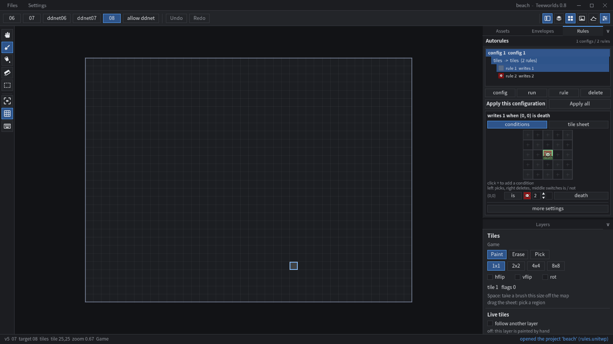

The workspace keeps that three level tree at the top — configurations, the runs of a
configuration, and the index rules of a run:

```
config 1  mountain
  run 1  ->  tiles   (3 rules)
    rule 1  writes 1
    rule 2  writes 3
    rule 3  writes 9
```

Under the tree is the part a row of numbers cannot say: a picture of the selected rule.
The tile the rule writes is drawn from the layer's own art in the centre of a grid, and
every position condition is drawn at the offset it tests, with the tile it reads and a
colour for its sense — green for *is*, red for *is not*, amber for a guide. Clicking an
empty cell adds a condition there, a left click on a condition selects it, a right click
removes it and the middle click switches *is* and *is not*; the fields under the grid
edit the selected condition. The `tile sheet` page swaps the grid for the layer's sheet,
so the tile a rule writes is picked by its picture rather than by its number.

The rule is also stated in words above the picture — "writes 1 when (0,0) is death" —
so a glance is enough to know what it does, and an empty grid cell carries a `+` with a
one-line legend under the grid saying what each click does. The fields a mapmaker rarely
touches (the rule name, flags and randomness, the run and its reference, the region)
stay folded behind `more settings`, so the first screen is only the sentence, the
picture and the condition being edited.

A rule names the tile it writes, its flags, the conditions under which it fires (a tile
at an offset that must, or must not, be one of a list), a modulo condition ("every third
column"), a random probability, and whether to skip empty or full source cells. A **run**
names the engine layer it reads and the one it writes, and a **configuration** names the
region it applies to. The tile a rule writes can be named by role — `hookable`, `death`,
`unhookable`, `freeze`, `unfreeze`, `deep_freeze`, `deep_unfreeze`, `live_freeze`,
`live_unfreeze` — instead of by a raw index, so a rule set survives a change of tileset.

`Apply this configuration` and `Apply all` run the rules over the layer the layer panel
has selected, and the whole run is undoable in one step. The same engine is what the
`rules.apply` method calls, so a script and the workspace cannot disagree.

The rule set travels inside the project file, and `rules.import` reads a DDRaceNetwork
`.rules` file as well, so the rule sets that ship with DDRace can be opened, edited and
applied here.

### Live tiles

Live tiles are the simple sibling of the autorules workspace. Instead of a rule document that
is applied when you ask, a **tile layer** can be told to follow another tile layer, and the
cells it covers are rewritten from the source the moment the source is painted. It is a
property of the layer, so it lives in the layer panel rather than in the Rules workspace, which
stays the batch automapper.

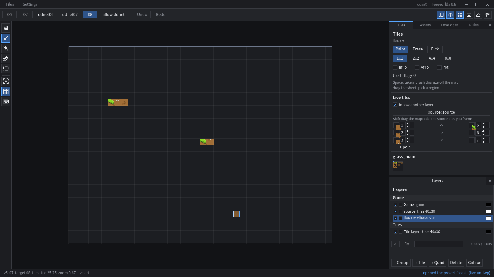

The section is small on purpose:

* **follow another layer** turns it on;
* **source** walks the other tile layers of the map, and the whole layer is rewritten from the
  one that is picked;
* the **pairs** are the whole language: a source tile index on the left, the tile written here
  on the right, each drawn with the layer's own art. A source tile with no pair becomes empty;
* **Shift** drag on the map takes the source tiles the marquee covers and adds a pair for each,
  which is how the tiles to watch are chosen by framing them instead of typing indices.

The pass is a plain function, so there is no randomness in it: a rule that needs a probability
belongs in the autorules workspace, where a rule carries a random weight. A project stores the
configuration inside itself, so it survives a reopen - the `.map` format has no room for it,
the project does. The same pass drives the `live.get` and `live.set` methods, so a script and
the panel cannot disagree.

### DDRace, and what the targets gate

DDRaceNetwork extends a map in three ways that the vanilla formats do not have: five
**physics layers** (teleporters, speedups, front, switch and tune, each with its own
payload in the 92 byte tilemap item), a larger set of **game layer entities** (the
lasers, plasma, draggers, doors and the extra armour and weapon tiles), and **UUID
items** that this editor does not model but preserves.

A **game layer** is painted like any other tile layer, but its palette is the **entity
sheet itself**: the 16 by 16 image the client draws entities from, with the cell under
the cursor named in a tooltip (`spawn_red is cell 193 of the sheet: click to paint it`)
and a click putting that sprite in the brush. A cell of a game layer stores the *cell
index* of that sheet, not the entity number, so what the palette shows and what the
canvas draws are the same number - which is also how the reference client addresses it.
Every non-empty cell is drawn from that sheet, the **tile controllers** above the entity
offset included (the freeze, death and switch markers of DDRace live in the same image):
the client copies a cell out of the sheet by its column and row, so the canvas shows the
same picture, and an index is only ever printed as a number when no sheet is installed at
all.
Picking from the picture rather than from a list of names is the point: an entity is
something you recognise, not something you spell.

Those features are gated by two things working together:

* the **target**'s extension bits — `ddnet06`, `ddnet07` and the package profile carry
  all of them; `07` and `08` carry the sounds, the bezier envelopes and the preserved
  UUID items; `06` carries the bezier envelopes only, because Teeworlds 0.6 has no sound
  item type and predates the DDRace items;
* the editor's **allow DDRace extensions** switch, which is in the toolbar next to the
  targets.

| | switch off | switch on |
|---|---|---|
| physics layers in a vanilla target | dropped on export, with a warning that names the switch | written, with a warning that a vanilla client ignores them |
| DDRace entities in a vanilla target | kept but they render as unknown tiles, with a warning | same, and the warning is part of the export report |
| DDRace UUID items in `07`/`08`/DDRace | preserved as they are | preserved as they are |
| DDRace UUID items in `06` | dropped, with a warning | dropped, with a warning |
| DDRace target | everything is kept | everything is kept |

The switch is a deliberate escape hatch rather than a mode: a map maker who wants a laser
in a 0.6 map can have one and is told what it costs. With the switch off, a physics layer
is still shown, marked read only, and preserved verbatim — nothing is silently thrown
away until the export, and the export says what it dropped.

The physics layers are editable when the switch is on: `Front`, `Tele`, `Speedup`,
`Switch` and `Tune` can be added to a group, the payload of a cell can be read and
written through the `physics.*` methods, and the layer draws with the DDRace sprite sheet
for its kind. The extended set of game entities is offered in the entity palette, each
one marked with whether it is a DDRace only entity, and placing one while the switch is
off is refused with the reason rather than silently ignored.

The tile index of a DDRace physics cell is derived, not stored: the visible tile is
mirrored out of the payload's type byte, so painting the layer and writing the payload
keep the picture and the data in step.

### The asset browser

The **Assets** dock is the images and the sounds the map carries, which is the part of
the DDRaceNetwork editor a map maker uses most: dropping in a tileset, embedding it so
the map travels on its own, replacing one that changed. A list of names would not do, so
every entry draws a thumbnail of the real pixels, and its second line says what the map
stores: the size, whether it is embedded, and how many layers use it.

For an **image** the browser offers:

* **Import** — a system file dialog; PNG, JPEG, TGA, BMP and GIF are decoded. A name the
  map already uses replaces that image instead of adding a second one with the same
  name, which no client could tell apart.
* **Sound** — the same dialog for audio, which adds it embedded: a map is where a
  sound's bytes live.
* **Embed** / **Free** — embedding copies the mapres pixels into the map, so a client
  that does not have `mapres/<name>.png` still draws it; freeing it again goes back to
  the external reference. Freeing is refused when there is no mapres file to fall back
  on, rather than leaving a map that points at nothing.
* **Replace** — new pixels for an existing image, keeping its index, so every layer that
  used it keeps working.
* **Export** — writes the PNG out: an embedded image from its pixels, an external one
  from the mapres file the client would use.
* **Remove** — drops it and renumbers every layer that referenced it.

A **sound** entry shows its length, decoded from the `.opus` header with opusfile in the
windowed build. Selecting one and pressing **Play** (or clicking it twice) plays it
through SDL3's audio device, so a sound can be placed by ear; the sound layer is added
with `sound_layers.add`, its sources are points in world space, and the preview is what
the DDRaceNetwork editor does here too.

All of it is also available without a window: `images.*` and `sounds.*` are agent
methods, so a script can import a tileset, embed it, place a sound layer and export the
map. `sounds.add` takes a file, the version's `audio/<name>.opus` resource, or base64
opus bytes, and `images.add` accepts raw RGBA in base64 for a tileset that was generated
rather than drawn.

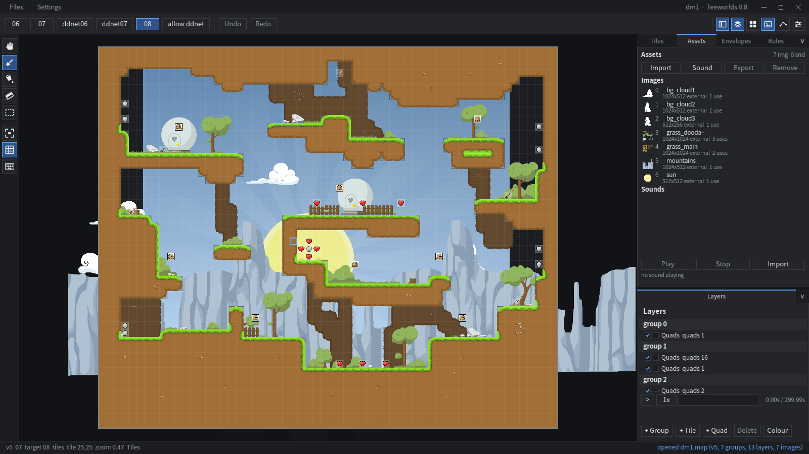

## Assets: 0.6 and 0.7 are not interchangeable

Every one of the 28 mapres file names exists in both 0.6 and 0.7 with **different
pixels** (most 0.7 backdrops are twice the resolution), and DDRaceNetwork adds a third
set with 26 names of its own, so the images live in per version directories:

```
data/
  versions/06/mapres/      vanilla Teeworlds 0.6 (tag 0.6-endofline, 28 files)
  versions/07/mapres/      vanilla Teeworlds 0.7.6 and 0.8 (identical bytes, 32 files)
  versions/ddnet/mapres/   DDRaceNetwork, a third set: 54 files, the _0.7 twins included
  shared/editor/           the editor sprites (entities.png and friends)
  shared/mapres/           search path for images identical in every version (empty)
  maps/06, maps/07, maps/08  bundled sample maps of each format
```

The directories were filled once from the reference checkouts (`teeworlds` tags
`0.6-endofline` and `0.7.6`, and `ddnet`) and are committed, so a build needs no
checkout of them; [data/LICENSE.txt](data/LICENSE.txt) records which tag and which
directory each set came from, and [docs/FORMATS.md](docs/FORMATS.md) covers the
formats. The lookup order is the active version first, then the DDRace extras, then
shared, then the other vanilla version as a last resort, so a 0.6 map really gets the
0.6 tiles and a 0.7 map the 0.7 ones.

## The `.unitwp` package

A `.map` file can only hold the map. A package adds what an editor wants around it:

```
magic "UNITWP\0\1"   version   flags   then chunks: { id[4], size, data }
  META   key=value text: package id (a UUID), name, author, description, target,
         assets, timestamps, and the map file it came from
  MAP    the map as a datafile, using a lossless profile (DDRace tilemaps, every
         item preserved, envelope tangents kept)
  EDIT   the editor session as JSON: camera, brush, selection, dock layout, flags
  RULE   the autorules document as JSON
  RSRC   embedded resources, for example mapres/grass_main.png
  THUM   an optional PNG thumbnail
```

The map inside a package is normalised when it is loaded, so a package can be
exported to any target afterwards without going back to the original file. A project
*is* this file: `Ctrl+S` writes one, `--pack` writes one, `export.package` writes one,
and `--unpack` reads the map back out of any of them.

The images and the sounds a map carries are inside the map itself, not beside it: an
embedded image is its pixels in the map's data blocks, an embedded sound is its `.opus`
bytes, and `RSRC` is only for a package that wants to travel with the mapres files the
map references but does not embed.

## What is here

Working:

* datafile v3/v4/v5 reading, v4/v5 writing, zlib and zstd
* all five target profiles with the correct item versions, run length tiles, DDRace
  physics layers, the name packing with the +128 bias of the reference
* DDRace UUID items (automapper and friends) are preserved across a load and save,
  including the data blocks they point at
* embedded images (raw RGBA) and external mapres images, quads, envelopes,
  sounds, clipping groups
* **assets**: import, embed, free, replace, export and remove an image, the same for a
  sound, and a sound preview that really plays, all from the browser or from the
  `images.*` / `sounds.*` methods
* **projects**: one binary `.unitwp` document under the application data directory with
  the map, the editor state, the autorules and the metadata, and a separate export
  directory
* **the platform file dialogs** for open, save, save as, export and importing an asset
* the `.unitwp` package with embedded resources, still available for travelling
* the editor: camera, grid, tile painting with brush size, region stamps and flips,
  layer panel with visibility and locks, tile palette, undo/redo
* a **Krita style workspace**: a fixed tool box of drawn icons with hover tooltips, two
  stacked dockers with draggable tabs, collapsible panels, two draggable splitters,
  floating panels and the whole layout stored in the project
* an explicit canvas per layer kind: a tile layer gets the tile brush with the region
  stamp and its ghost preview (`Space` and the pick tool take a brush off the map), a
  quad layer gets its five editable points and is moved by dragging it, and the panels
  only show what the selection can do (see [The editor](#the-editor))
* an **envelope editor**: a curve view with draggable keyframes, an editable curve type
  including bezier, a point list with the four fixed point values, and the preview clock
  (see [The envelope editor](#the-envelope-editor))
* **autorules**: a JSON rule set, a tree of configurations, runs and index rules above a
  rendered picture of the selected rule, a tile sheet picker, and one step undo of a rule
  run (see
  [The autorules workspace](#the-autorules-workspace))
* **live tiles**: a tile layer that follows another one and is rewritten as the source is
  painted, with a source tile to written tile table and a Shift drag that takes the source tiles
  you frame (see [Live tiles](#live-tiles))
* **assets**: the image and sound browser with real thumbnails, import, embed, free,
  replace, export, remove, and a sound preview that plays the map's own `.opus` files
  through SDL3 (see [The asset browser](#the-asset-browser))
* **DDRace support**: the physics layers are visible, addable and editable, the DDRace
  game entities are in the palette with the right sprite sheet, and the
  `allow DDRace extensions` switch decides whether a vanilla target keeps them (see
  [DDRace, and what the targets gate](#ddrace-and-what-the-targets-gate))
* **the agent interface**: every operation as a JSON method, both as a one shot
  subcommand and as a resident session (see [docs/AGENT.md](docs/AGENT.md))
* the colours: the tile layer colour as a real RGBA multiplier, all four quad corner
  colours as a gradient, a colour picker that a right click aims at the corner it landed
  on — or at all four from inside the shape — and an envelope preview clock to watch
  colour and position envelopes (see
  [Colours and the envelope preview](#colours-and-the-envelope-preview))
* **a Krita style workspace**: a drawn icon tool box on the left with a hover tooltip
  per tool, two stacked dockers on the right (the layer tree at the bottom, the way
  Krita has it), tabs that can be dragged to reorder a docker or to move a workspace to
  the other one, a floating welcome page and shortcut list, and a five step neutral
  theme (see [The workspace](#the-workspace))
* a **fill (bucket) tool** for a tile layer: one click floods the region of one tile
  index, bounded by a tile budget so a misclick cannot lock the frame up, and a **move
  tool** that pans the view with the left button (`V`), which is what a tablet wants
* `--selftest`, the round trip regression test, 67 checks

Not here yet (called out so nothing is a surprise):

* **quad art and tile art**: neither the DDRace quad-art tool nor the tile-art tool is
  implemented, and neither is planned for this pass
* dragging the **bezier tangents** of a keyframe: the curve type is settable and the
  tangents are written Teeworlds style into every target, but they cannot be shaped
  with the mouse yet
* creating and deleting quads from the canvas: a quad's five points can be dragged and
  its four corner colours set, but a new quad cannot be added and one cannot be removed
  yet
* a **tune parameter editor**: a tune layer's payload can be read and written cell by
  cell through `physics.set`, but the named tune parameters have no form yet
* an **automapper config editor** for the DDRace UUID item: an imported automapper
  configuration is preserved verbatim, and its payload is not turned into editable rules
* writing the DDRace `.rules` text format: `rules.import` reads it, the project stores
  and writes the JSON rule set
* an **undo history panel**, copy/paste, flipping a whole layer, tile thumbnails in the
  palette beyond the sheet
* floating a **dock** into its own window: the panels that float (the welcome page and
  the shortcut list) are drawn over the canvas, but a dock cannot be torn off into a
  separate OS window yet
* parallax preview: layers are drawn with their group offset but without the
  camera dependent parallax of the client

## License

Uniteed is [MIT licensed](LICENSE), Copyright (c) 2026 Bamcane. That covers the code
and the documentation: `src/`, `tools/`, `docs/`, the build files and this README.

**The assets under `data/` are not covered by the MIT license**, with one exception:
`data/icons/*.svg` are the interface icons, drawn for this project, so they are MIT
like the rest of the code. Everything else stays under the licenses of the projects
they come from, and those parts of `data/` are released under **CC-BY-SA 3.0**,
exactly like Teeworlds its own `data` and `datasrc` directories. Besides the icons it
is the Teeworlds 0.6, Teeworlds 0.7.6 and DDRaceNetwork mapres sets plus a few of their
maps, collected per version so the editor has the right pixels for every format. The
authors, the exact source tag and directory of each set, and the per map credits are
listed in [data/LICENSE.txt](data/LICENSE.txt). The screenshots earlier in this file
are renders of that art, so they are CC-BY-SA 3.0 as well.

Third party code keeps its own license, one directory per library: `external/libsugarx`
(MIT), `external/stb` (`stb_image.h`, public domain / MIT, used only as the PNG
decoder) and `external/nanosvg` (zlib, the SVG parser and rasterizer behind the
interface icons). Everything else is written here: the JSON value and parser, the rule
engine and the `.unitwp` container are all part of `src/`. SDL3, FreeType, HarfBuzz,
zlib, libzstd and OpenSSL are linked from the system and not distributed here. The
project layout, the `storage` module and the typed config module follow
[TWICE](https://github.com/TeeMidnight/TWICE) (MIT, Copyright (c) 2025-2026
TeeMidnight); they are written anew, but the design is its.

The map format constants and structures are derived from Teeworlds and DDRaceNetwork,
**both zlib licensed**: Teeworlds is Copyright (C) 2007-2025 Magnus Auvinen and
contributors (plus the Teeworlds Archive Project additions, 2025-2026), and the DDNet
checkout adds DDRace Copyright (C) 2010-2011 Shereef Marzouk and DDNet Copyright (C)
Dennis Felsing. The format handling is an independent reimplementation written against
their documented file formats and item layouts, so the maps this editor writes are
accepted by their clients.
